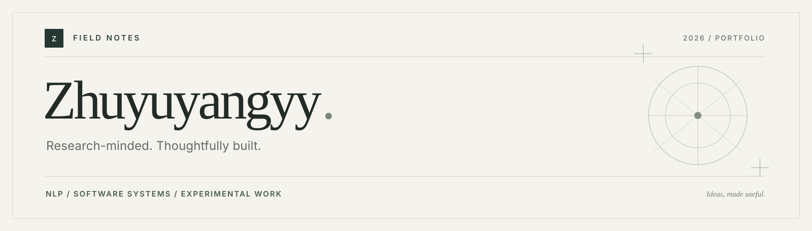

  

  <a href="#selected-work">Selected work</a> &nbsp; / &nbsp;
  <a href="#research-note">Research note</a> &nbsp; / &nbsp;
  <a href="#collaboration">Collaboration</a> &nbsp; / &nbsp;
  <a href="https://github.com/Zhuyuyangyy?tab=repositories">All repositories</a>

### About

I'm a **Data Science undergraduate** with a research-first approach to building software. My work moves between **medical NLP**, **reliable systems**, and **small, thoughtful products**.

I enjoy taking an idea all the way from an experiment to something others can inspect, reproduce, and use.

`Research & evaluation` &nbsp; / &nbsp; `Backend & agent systems` &nbsp; / &nbsp; `Product engineering`

---

### Selected work

**01 &nbsp; / &nbsp; [TCM-SD42](https://github.com/Zhuyuyangyy/TCM-SD42-Public-Reproducibility)** &nbsp; RESEARCH / MEDICAL NLP

A controlled comparison of four language models for syndrome differentiation, with reproducibility materials, statistical analysis, and documented limitations. The experiment uses a **fixed 42-class task derived from TCM-SD**.

Python &nbsp; / &nbsp; PyTorch &nbsp; / &nbsp; Transformers &nbsp; / &nbsp; Evaluation

**02 &nbsp; / &nbsp; [PhytoSkill-Spark](https://github.com/Zhuyuyangyy/PhytoSkill-Spark)** &nbsp; SYSTEMS / AGENT RUNTIME

Composable skills for medicinal-plant analysis, with an SDK, registry, execution runtime, verification gates, and repeatable test and evaluation workflows.

Python &nbsp; / &nbsp; Runtime design &nbsp; / &nbsp; Testing &nbsp; / &nbsp; Tooling

**03 &nbsp; / &nbsp; [EduMind](https://github.com/Zhuyuyangyy/EduMind)** &nbsp; APPLICATION / EDUCATION

A personalized learning system connecting learner profiles, retrieval-supported tutoring, learning-path planning, and traceable multi-agent workflows.

TypeScript &nbsp; / &nbsp; RAG &nbsp; / &nbsp; Application engineering

**04 &nbsp; / &nbsp; [Zhiguang-Planting](https://github.com/Zhuyuyangyy/Zhiguang-Planting)** &nbsp; PRODUCT / 3D WEB

A dental education prototype bringing together spatial visualization, question-answering, and a Spring Boot service layer.

Vue 3 &nbsp; / &nbsp; Three.js &nbsp; / &nbsp; Spring Boot

**05 &nbsp; / &nbsp; [daily-zero-decision](https://github.com/Zhuyuyangyy/daily-zero-decision)** &nbsp; PRODUCT / INTERACTION

A gentle habit and action app, with thoughtful interactions, browser-local progress, and a growing visual sky.

React &nbsp; / &nbsp; TypeScript &nbsp; / &nbsp; Product design

**06 &nbsp; / &nbsp; [Qwen2609-Evaluation](https://github.com/Zhuyuyangyy/Qwen2609-Evaluation)** &nbsp; TOOLING / REPRODUCIBILITY

Read-only benchmark result aggregation. Preserves the grader's verdicts and refuses to publish a formal rate for partial runs.

Python &nbsp; / &nbsp; Evaluation tooling &nbsp; / &nbsp; Result provenance

---

### Research note

In the **TCM-SD42 controlled comparison**, the domain-specific encoder ZY-BERT achieved **75.77% accuracy** and **66.51% macro-F1** on the clean held-out split (**N = 4,218**). These results describe the study's historical, fixed **TCM-SD-derived 42-class task**, *not* the official normalized 148-class TCM-SD benchmark.

[Methods, statistical tests, and reproducibility materials &rarr;](https://github.com/Zhuyuyangyy/TCM-SD42-Public-Reproducibility)

### Collaboration

I also contribute to shared codebases. A few merged PRs in the collaborator-owned public repository [`tangjue3/v4`](https://github.com/tangjue3/v4):

[Frontend and backend APIs &middot; #1](https://github.com/tangjue3/v4/pull/1) &nbsp; / &nbsp; [Homepage redesign &middot; #7](https://github.com/tangjue3/v4/pull/7) &nbsp; / &nbsp; [Local deployment, MySQL, RAG &middot; #11](https://github.com/tangjue3/v4/pull/11)

### Working toolkit

**Research:** Python / PyTorch / Transformers / LoRA & QLoRA  
**Systems:** FastAPI / retrieval / agent workflows / testing / Docker  
**Products:** TypeScript / React / Vue / Spring Boot / Three.js

---

  Build carefully. Measure honestly. Keep learning.
   
  <a href="https://github.com/Zhuyuyangyy?tab=repositories">Explore the work &rarr;</a>

